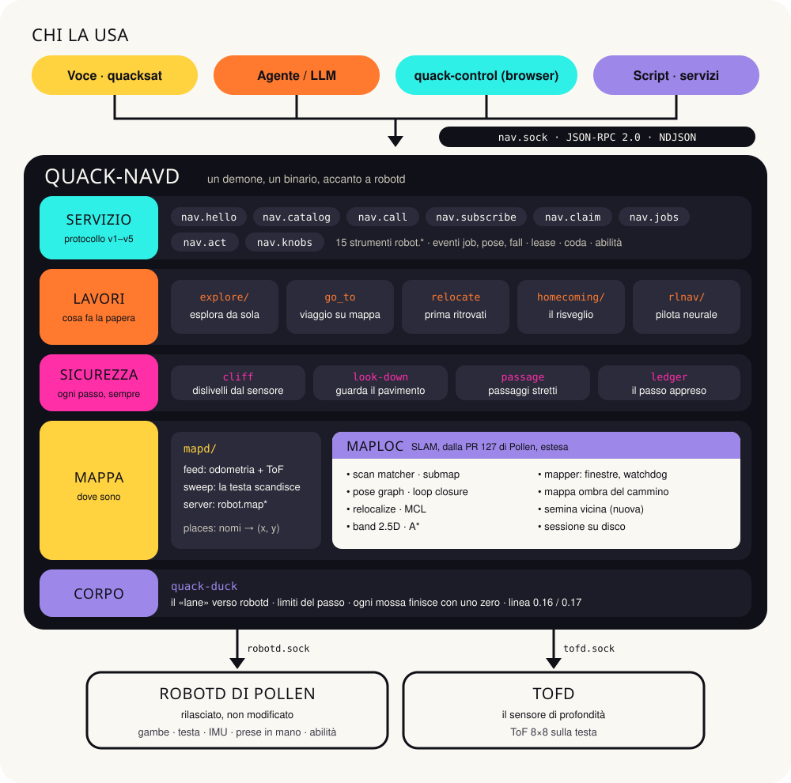
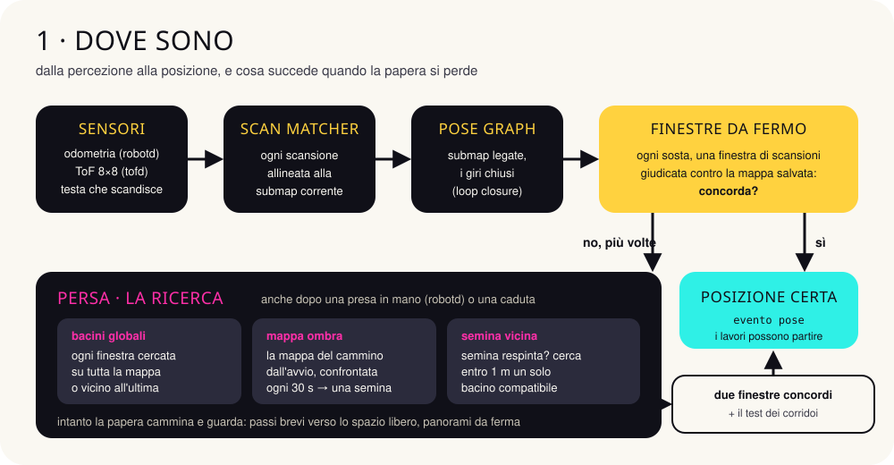
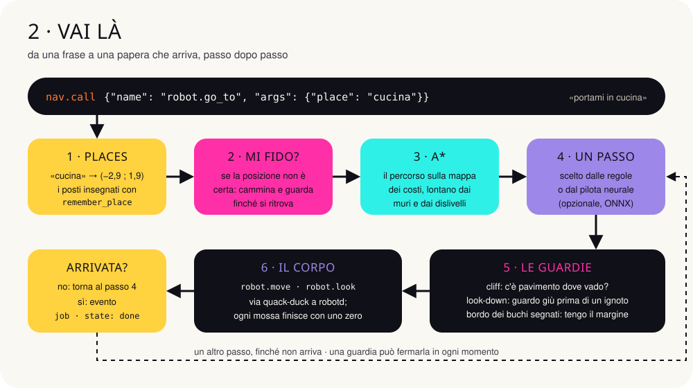
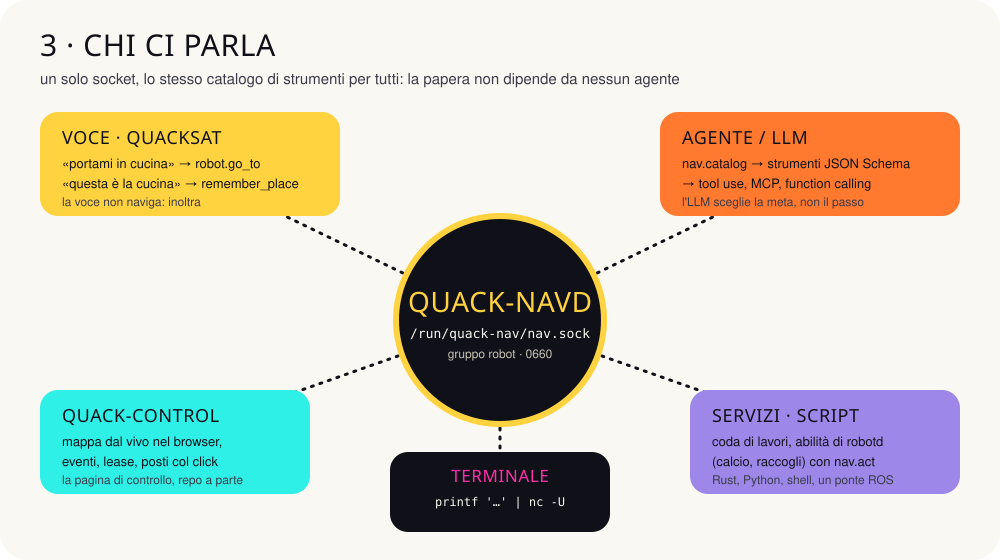

# quack-nav

**Dove si trova la papera, e come arriva da un'altra parte.**

Navigazione per il [Microduck](https://pollen-robotics.com/microduck/): un demone,
`quack-navd`, che si affianca a robotd di Pollen. La papera mappa la casa da sola,
riconosce dove si trova, va dove le si chiede e si ritrova dopo una caduta o dopo
essere stata presa in mano. Lo può comandare chiunque: la voce, un agente, una
pagina web, uno script.
Copia inglese: [architecture.md](architecture.md).

> **Un esperimento.** Tutti i numeri di questa pagina sono stati misurati sul
> gemello MuJoCo e sul banco simulato, mai su una papera fisica: la prima sessione
> sul robot vero è prevista per dicembre 2026. Progetto indipendente, non affiliato
> a Pollen Robotics. Apache-2.0.

## In numeri

| | | |
|---|---|---|
| **48/48** viaggi arrivati sul gemello (4 giri × 2 case) | **0** cadute nei dislivelli su 12.600 viaggi spericolati | **17/24** volte si ritrova giusta dopo uno spostamento o una caduta (prima: 2/24) |
| **8/8** ritrovata dopo essere stata presa in mano | **23/24** risvegli: riconosce la casa e il punto | **98,6 %** di arrivi su 840 viaggi del banco |

## Architettura



Un solo binario, cinque strati. Dall'alto:

- **Servizio.** Un socket Unix che parla come robotd: JSON-RPC 2.0, una riga per
  messaggio. Offre 15 strumenti `robot.*`, eventi, un lease (uso esclusivo), una coda
  di lavori e le abilità di robotd. Il protocollo è versionato, oggi alla v5.
- **Lavori.** Ciò che la papera fa:
  - esplorare da sola;
  - andare a un posto;
  - ritrovarsi prima di partire;
  - riconoscere la casa al risveglio;
  - un pilota neurale opzionale che sceglie i passi.
- **Sicurezza.** A ogni passo: il sensore controlla che il pavimento ci sia, la testa
  guarda giù prima di camminare su ciò che la mappa non conosce, i passaggi stretti
  sono gestiti con attenzione, e un registro impara il passo di questa papera.
- **Mappa.** `maploc` è la SLAM, cioè mappa e posizione insieme. Deriva dalla PR 127
  di Pollen ed è estesa. Gira su un suo thread dentro il demone, nutrita
  dall'odometria di robotd e dal sensore di profondità di tofd.
- **Corpo.** `quack-duck` è l'unica strada verso robotd. Conosce i limiti del passo e
  le due linee del demone di Pollen (0.16 e 0.17), e chiude ogni mossa con un comando
  zero.

| crate | a cosa serve |
|---|---|
| `quack-duck` | client di robotd, condiviso con la voce; limiti del passo; comandi del corpo |
| `maploc` | SLAM: scan matcher, submap, pose graph, loop closure, rilocalizzazione, sessioni |
| `quack-nav` | il demone `quack-navd` e tutto ciò che sta sopra la mappa |
| `quack-nav-proto` | i tipi del protocollo, condivisi da demone e client |
| `quack-nav-client` | un client Rust pronto all'uso |
| `quack-rl` | case generate, simulatore, banco e addestramento del pilota |

## Come funziona



Mentre cammina, la papera allinea ogni scansione alla mappa. Quando si ferma,
confronta una finestra di scansioni con la mappa salvata. Se la mappa la contraddice
più volte, oppure se robotd segnala che qualcuno l'ha presa in mano o che è caduta,
la posizione non è più affidabile e parte la ricerca:

- **bacini globali:** ogni finestra viene cercata su tutta la mappa;
- **mappa ombra:** la mappa del cammino fatto dall'avvio viene confrontata con quella
  salvata ogni 30 s, e dà una semina, cioè una posizione da verificare;
- **semina vicina:** se una finestra respinge la semina, la papera cerca un solo
  candidato compatibile entro 1 m.

La posizione torna affidabile quando due finestre concordano e il test dei corridoi
non trova ambiguità.



Una richiesta `robot.go_to` diventa un lavoro:

1. il nome del posto diventa coordinate;
2. se la posizione è incerta, la papera prima si ritrova;
3. A* traccia il percorso;
4. poi i passi, uno alla volta, ciascuno controllato dalle guardie.

La fine arriva come evento `job` con `state: done` (o `failed`, con il motivo).

## Integrazioni



Tutti usano lo stesso socket, `/run/quack-nav/nav.sock`, e lo stesso catalogo. La
papera non dipende da nessun agente in particolare.

### Dal terminale

```sh
S=/run/quack-nav/nav.sock
# chi sei?
printf '{"jsonrpc":"2.0","id":1,"method":"nav.hello","params":{"client":"shell"}}\n' | nc -U $S
# dove sono?
printf '{"jsonrpc":"2.0","id":2,"method":"nav.call","params":{"name":"robot.where_am_i","args":{}}}\n' | nc -U $S
# insegna il posto in cui si trova, poi esplora la casa
printf '{"jsonrpc":"2.0","id":3,"method":"nav.call","params":{"name":"robot.remember_place","args":{"name":"cucina"}}}\n' | nc -U $S
printf '{"jsonrpc":"2.0","id":4,"method":"nav.call","params":{"name":"robot.map_explore","args":{}}}\n' | nc -U $S
```

### Da Python: vai in cucina e aspetta l'arrivo

Gli eventi viaggiano su una connessione dedicata. La richiesta parte su un'altra.

```python
import json, socket

SOCK = "/run/quack-nav/nav.sock"

def messages(conn):
    buf = b""
    while chunk := conn.recv(4096):
        buf += chunk
        while b"\n" in buf:
            line, buf = buf.split(b"\n", 1)
            yield json.loads(line)

def send(conn, id, method, params):
    conn.sendall((json.dumps({"jsonrpc": "2.0", "id": id, "method": method, "params": params}) + "\n").encode())

events = socket.socket(socket.AF_UNIX); events.connect(SOCK)
send(events, 1, "nav.subscribe", {"topics": ["job"]})
stream = messages(events); next(stream)            # la risposta: i topic concessi

with socket.socket(socket.AF_UNIX) as ask:
    ask.connect(SOCK)
    send(ask, 2, "nav.call", {"name": "robot.go_to", "args": {"place": "cucina"}})
    print(next(messages(ask)))                      # il lavoro è partito

for msg in stream:
    if msg.get("method") == "nav.event":
        job = msg["params"]["data"]
        if job["state"] in ("done", "failed"):
            print(job["state"], job.get("reason"))
            break
```

### Da Rust, con il client

```rust
use quack_nav_client::{Client, subscribe};
use serde_json::json;

let mut nav = Client::connect("/run/quack-nav/nav.sock")?;
nav.hello("my-service")?;
nav.call("robot.go_to", json!({"place": "cucina"}))?;
for event in subscribe("/run/quack-nav/nav.sock", &["job"])? {
    if event?.data["state"] == "done" { break }
}
```

### Un agente LLM

Il catalogo è già fatto di strumenti in JSON Schema. Basta passarli al modello: l'LLM
sceglie la meta, mentre il percorso, i passi e le guardie restano alla papera.

```python
import anthropic

catalog = nav_request("nav.catalog", {})            # [{name, description, parameters}, …]
tools = [{"name": t["name"].replace(".", "_"),      # i nomi degli strumenti non ammettono il punto
          "description": t["description"],
          "input_schema": t["parameters"]} for t in catalog]

client = anthropic.Anthropic()
reply = client.messages.create(
    model="claude-opus-5-5", max_tokens=1024, tools=tools,
    messages=[{"role": "user", "content": "Vai a vedere se in cucina c'è qualcuno"}])
for block in reply.content:
    if block.type == "tool_use":
        result = nav_request("nav.call", {"name": block.name.replace("_", ".", 1), "args": block.input})
```

`nav_request` è la funzione `send` più `messages` dell'esempio Python. Lo stesso
catalogo si proietta su MCP o sul function calling di altri modelli.

### Una coda di lavori e un'abilità di robotd

```sh
# un giro: cucina, poi salotto, e avanti anche se una tappa fallisce
printf '%s\n' '{"jsonrpc":"2.0","id":1,"method":"nav.jobs","params":{"on_failure":"continue","steps":[{"tool":"robot.go_to","args":{"place":"cucina"}},{"tool":"robot.go_to","args":{"place":"salotto"}}]}}' | nc -U $S
# vai in salotto e lì esegui un'abilità che robotd elenca in robot.skills
printf '{"jsonrpc":"2.0","id":2,"method":"nav.act","params":{"skill":"ball_kick_left","at":"salotto"}}\n' | nc -U $S
```

### Una pagina di controllo: il lease

Una pagina che guida la papera a mano prende un lease, cioè l'uso esclusivo delle
mosse, con `nav.claim`. Lo rinnova finché serve e lo rilascia con `nav.release`.
Intanto gli altri client possono leggere, ma non muovere la papera, e uno stop è
sempre accettato.

```json
{"jsonrpc":"2.0","id":1,"method":"nav.claim","params":{"holder":"pagina di controllo","ttl_s":60}}
```

## Limiti noti

- **Caduta in casa_arredata:** la papera si ritrova solo 1 volta su 4.
- **Ricerca dopo un trasporto:** richiede circa 2–3 minuti.
- **Oggetti bassi:** sotto i 9 cm circa il sensore li perde mentre cammina.
- **Persone ferme sulla porta:** la papera ci va addosso invece di aspettare.
- **Esplorazione:** arriva a circa due terzi della casa in tre sessioni da 30 minuti.
- **Campioni piccoli:** spesso sono 4 prove per tipo, quindi va letta la tendenza, non
  il singolo numero.

---

quack-nav · [github.com/andreagenovese/quacknav](https://github.com/andreagenovese/quacknav) ·
main `a51da41`, 13 novembre 2026 · progetto indipendente, non affiliato a Pollen Robotics
