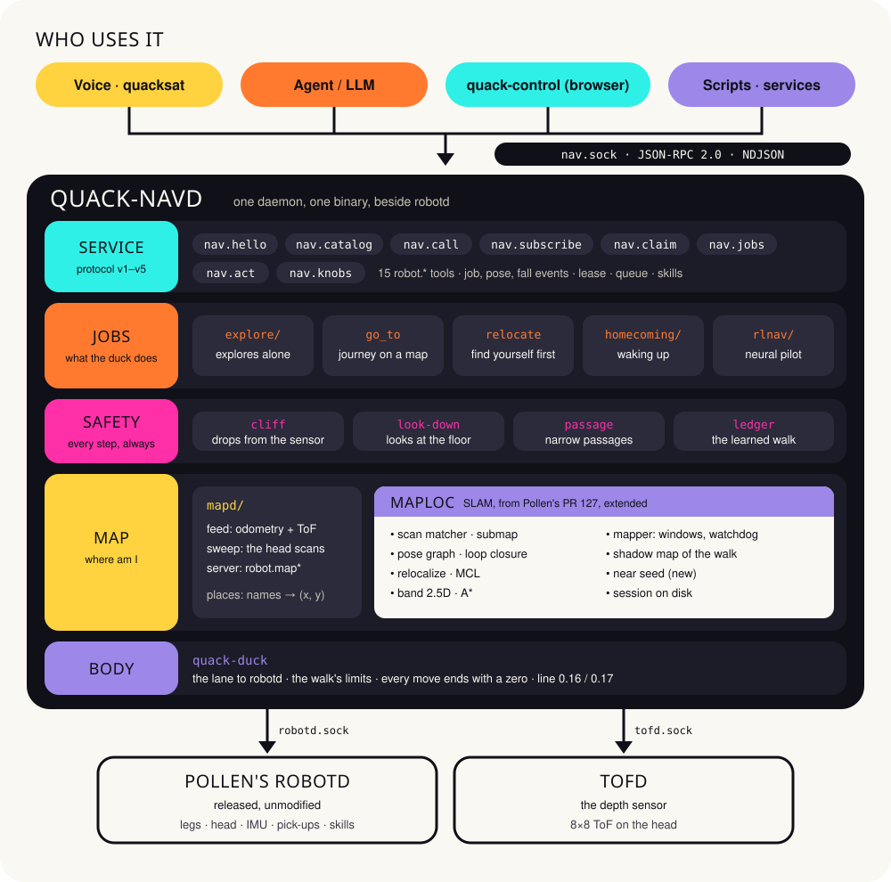
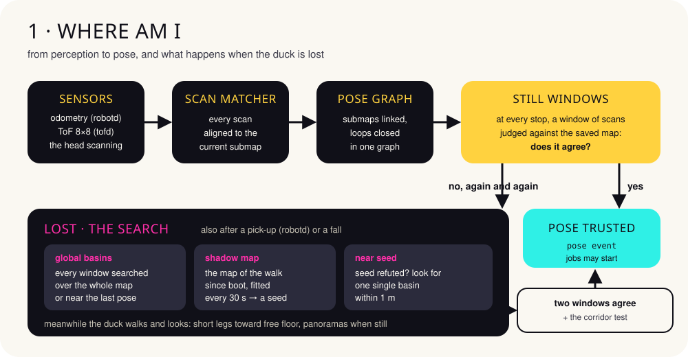
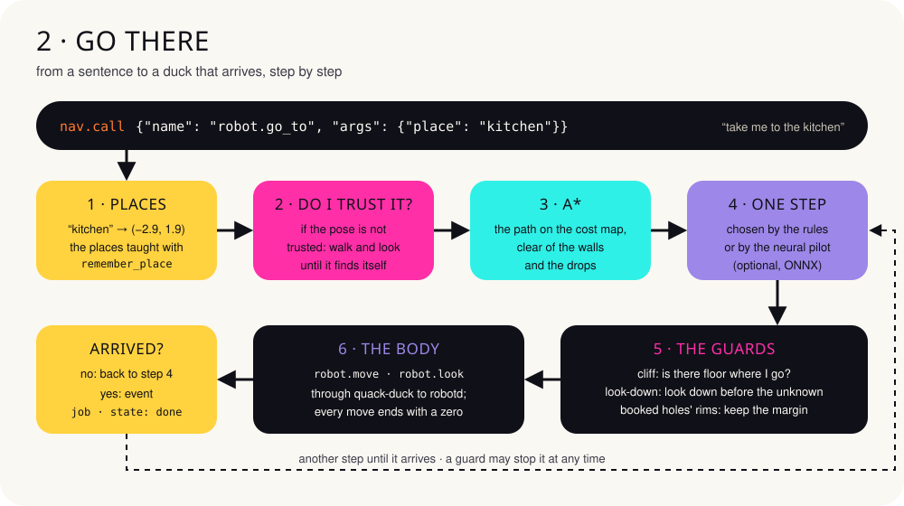
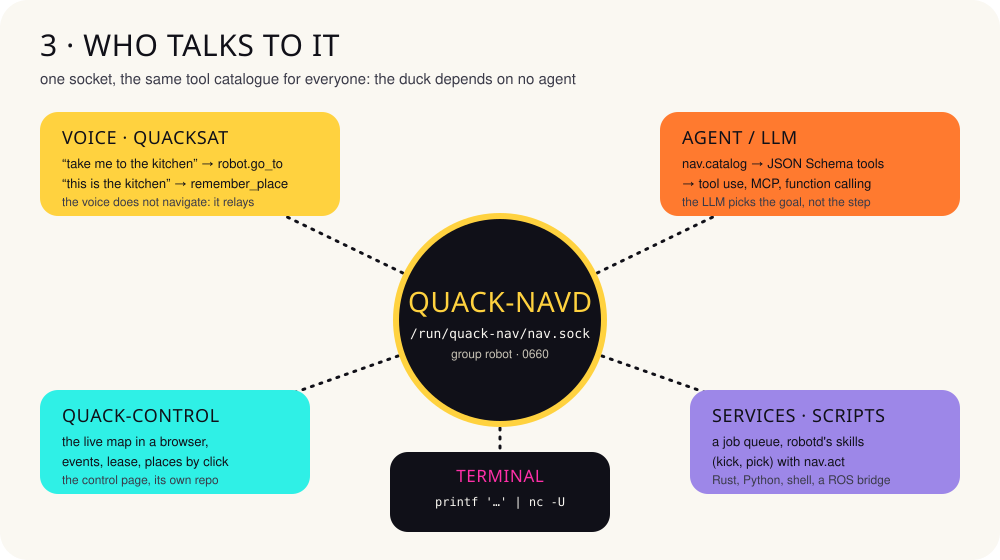

# quack-nav

**Where the duck is, and how it gets somewhere else.**

Navigation for the [Microduck](https://pollen-robotics.com/microduck/): a daemon,
`quack-navd`, that runs beside Pollen's robotd. The duck maps the house on its own,
knows where it is, goes where it is asked, and finds itself again after a fall or after
being picked up. Anyone can drive it: a voice, an agent, a web page, a script.
Italian copy: [architecture.it.md](architecture.it.md).

> **An experiment.** Every number on this page was measured on the MuJoCo twin and on
> the simulated bench, never on a physical duck: the first session on the real robot
> is planned for December 2026. Independent project, not affiliated with Pollen
> Robotics. Apache-2.0.

## In numbers

| | | |
|---|---|---|
| **48/48** journeys arrived on the twin (4 tours × 2 houses) | **0** falls into a drop in 12,600 reckless journeys | **17/24** times it finds itself right after a carry or a fall (before: 2/24) |
| **8/8** found again after being picked up and carried | **23/24** wake-ups: it knows the house and the spot | **98.6 %** arrivals over 840 bench journeys |

## Architecture



One binary, five layers. From the top:

- **Service.** A Unix socket that speaks like robotd: JSON-RPC 2.0, one message per
  line. It offers 15 `robot.*` tools, events, a lease (exclusive use), a job queue and
  robotd's skills. The protocol is versioned, v5 today.
- **Jobs.** What the duck does:
  - explore on its own;
  - go to a place;
  - find itself before setting out;
  - recognise the house when it wakes up;
  - an optional neural pilot that chooses the steps.
- **Safety.** At every step: the sensor checks that the floor is there, the head looks
  down before walking onto what the map does not know, narrow passages are threaded
  with care, and a ledger learns this duck's own walk.
- **Map.** `maploc` is the SLAM, map and pose together. It comes from Pollen's PR 127,
  extended. It runs on its own thread inside the daemon, fed by robotd's odometry and
  by tofd's depth sensor.
- **Body.** `quack-duck` is the only way to robotd. It knows the walk's limits and the
  two lines of Pollen's daemon (0.16 and 0.17), and ends every move with a zero
  command.

| crate | what it is for |
|---|---|
| `quack-duck` | robotd's client, shared with the voice; the walk's limits; the body's commands |
| `maploc` | SLAM: scan matcher, submaps, pose graph, loop closure, relocalization, sessions |
| `quack-nav` | the `quack-navd` daemon and everything above the map |
| `quack-nav-proto` | the protocol's types, shared by the daemon and its clients |
| `quack-nav-client` | a ready-made Rust client |
| `quack-rl` | generated houses, simulator, bench and the pilot's training |

## How it works



While it walks, the duck aligns every scan to the map. When it stops, it judges a
window of scans against the saved map. If the map contradicts it again and again, or if
robotd says someone picked it up or it fell, the pose is no longer trusted and the
search starts:

- **global basins:** every window is searched over the whole map;
- **shadow map:** the map walked since boot is fitted to the saved one every 30 s and
  gives a seed, a pose to be checked;
- **near seed:** when a window refutes the seed, the duck looks for one single
  compatible basin within 1 m.

The pose is trusted again when two windows agree and the corridor test finds no
ambiguity.



A `robot.go_to` becomes a job:

1. the place's name becomes coordinates;
2. if the pose is not trusted, the duck finds itself first;
3. A* plans the path;
4. then the steps, one at a time, each watched by the guards.

The end arrives as a `job` event with `state: done` (or `failed`, with the reason).

## Integrations



Everyone uses the same socket, `/run/quack-nav/nav.sock`, and the same catalogue. The
duck depends on no particular agent.

### From a terminal

```sh
S=/run/quack-nav/nav.sock
# who are you?
printf '{"jsonrpc":"2.0","id":1,"method":"nav.hello","params":{"client":"shell"}}\n' | nc -U $S
# where am I?
printf '{"jsonrpc":"2.0","id":2,"method":"nav.call","params":{"name":"robot.where_am_i","args":{}}}\n' | nc -U $S
# teach the spot it stands in, then explore the house
printf '{"jsonrpc":"2.0","id":3,"method":"nav.call","params":{"name":"robot.remember_place","args":{"name":"kitchen"}}}\n' | nc -U $S
printf '{"jsonrpc":"2.0","id":4,"method":"nav.call","params":{"name":"robot.map_explore","args":{}}}\n' | nc -U $S
```

### From Python: go to the kitchen and wait for the arrival

The events travel on a connection of their own; the request goes on another.

```python
import json, socket

SOCK = "/run/quack-nav/nav.sock"

def messages(conn):
    buf = b""
    while chunk := conn.recv(4096):
        buf += chunk
        while b"\n" in buf:
            line, buf = buf.split(b"\n", 1)
            yield json.loads(line)

def send(conn, id, method, params):
    conn.sendall((json.dumps({"jsonrpc": "2.0", "id": id, "method": method, "params": params}) + "\n").encode())

events = socket.socket(socket.AF_UNIX); events.connect(SOCK)
send(events, 1, "nav.subscribe", {"topics": ["job"]})
stream = messages(events); next(stream)            # the answer: the topics granted

with socket.socket(socket.AF_UNIX) as ask:
    ask.connect(SOCK)
    send(ask, 2, "nav.call", {"name": "robot.go_to", "args": {"place": "kitchen"}})
    print(next(messages(ask)))                      # the job has started

for msg in stream:
    if msg.get("method") == "nav.event":
        job = msg["params"]["data"]
        if job["state"] in ("done", "failed"):
            print(job["state"], job.get("reason"))
            break
```

### From Rust, with the client

```rust
use quack_nav_client::{Client, subscribe};
use serde_json::json;

let mut nav = Client::connect("/run/quack-nav/nav.sock")?;
nav.hello("my-service")?;
nav.call("robot.go_to", json!({"place": "kitchen"}))?;
for event in subscribe("/run/quack-nav/nav.sock", &["job"])? {
    if event?.data["state"] == "done" { break }
}
```

### An LLM agent

The catalogue is already made of JSON Schema tools. Hand them to the model: the LLM
picks the goal, while the path, the steps and the guards stay with the duck.

```python
import anthropic

catalog = nav_request("nav.catalog", {})            # [{name, description, parameters}, …]
tools = [{"name": t["name"].replace(".", "_"),      # tool names do not allow the dot
          "description": t["description"],
          "input_schema": t["parameters"]} for t in catalog]

client = anthropic.Anthropic()
reply = client.messages.create(
    model="claude-opus-5-5", max_tokens=1024, tools=tools,
    messages=[{"role": "user", "content": "Go and see whether anyone is in the kitchen"}])
for block in reply.content:
    if block.type == "tool_use":
        result = nav_request("nav.call", {"name": block.name.replace("_", ".", 1), "args": block.input})
```

`nav_request` is the Python example's `send` plus `messages`. The same catalogue
projects onto MCP or onto other models' function calling.

### A job queue and one of robotd's skills

```sh
# a round: kitchen, then living room, and on even if a stop fails
printf '%s\n' '{"jsonrpc":"2.0","id":1,"method":"nav.jobs","params":{"on_failure":"continue","steps":[{"tool":"robot.go_to","args":{"place":"kitchen"}},{"tool":"robot.go_to","args":{"place":"living room"}}]}}' | nc -U $S
# go to the living room and there run a skill robotd lists in robot.skills
printf '{"jsonrpc":"2.0","id":2,"method":"nav.act","params":{"skill":"ball_kick_left","at":"living room"}}\n' | nc -U $S
```

### A control page: the lease

A page that drives the duck by hand takes a lease, exclusive use of the moves, with
`nav.claim`. It renews it while it needs it and gives it back with `nav.release`.
Meanwhile the other clients can read but not move the duck, and a stop is always
accepted.

```json
{"jsonrpc":"2.0","id":1,"method":"nav.claim","params":{"holder":"control page","ttl_s":60}}
```

## Known limits

- **A fall in casa_arredata:** the duck finds itself only 1 time in 4.
- **The search after a carry:** takes about 2–3 minutes.
- **Low things:** under about 9 cm the sensor loses them while walking.
- **People standing in a doorway:** the duck bumps into them instead of waiting.
- **Exploration:** reaches about two thirds of the house in three 30-minute sessions.
- **Small samples:** often 4 trials a kind, so read the trend, not the single number.

---

quack-nav · [github.com/andreagenovese/quacknav](https://github.com/andreagenovese/quacknav) ·
main `a51da41`, 13 November 2026 · independent project, not affiliated with Pollen Robotics
